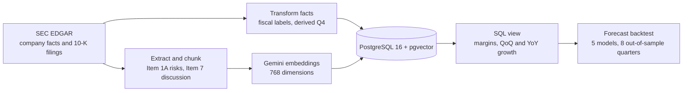
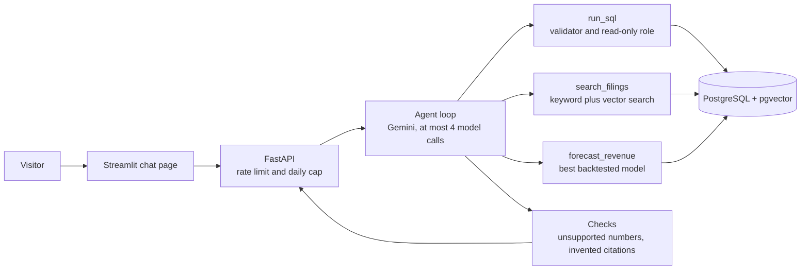
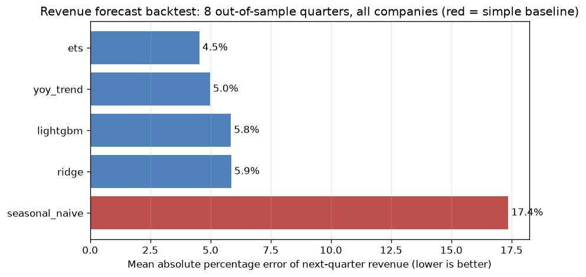

# SEC Copilot

**A financial-analyst assistant for 15 US tech companies that cites every answer.**

[](https://github.com/arpitk2509/sec-copilot/actions/workflows/ci.yml)

Ask a question in plain English. The assistant answers with numbers from a SQL database built from SEC EDGAR data, explanations from passages of the companies' 10-K filings, and forecasts from a backtested time-series model. Every claim carries a citation, and a checker flags any number that does not appear in a source.

> Not financial advice. This is a portfolio project built on free-tier APIs and public data.

## What it looks like

**Q:** *Forecast Micron's revenue for its next quarter. How much should I trust it?*

> Micron's next-quarter revenue is forecast at approximately $64.3 billion for the quarter ending around December 3, 2026, with an 80% range of $58.1 billion to $88.6 billion **[F1]**. You should view this with moderate-to-low trust. It is a purely statistical estimate based solely on past revenue and does not account for guidance, new products, or macroeconomic conditions **[F1]**. The model's average backtest error for Micron is 14.2% (compared to 4.5% across all companies) **[F1]**.

**Q:** *Why did Intel's operating margin turn negative?* (Intel's 10-K text could not be extracted, and the assistant says so instead of guessing.)

> Intel's operating margin turned negative in several quarters, including -68.18% for the period ended 2024-09-28 **[Q1]**. Intel's 10-K text is not loaded in the system, so the filings cannot be searched to explain the reasons.

Citation tags: **[Q]** a SQL result, **[C]** a filing excerpt, **[F]** a forecast. The chat page shows each cited source (the SQL that ran, the excerpt, the forecast details) in expandable panels.

## Design rules

1. **Numbers come only from SQL.** Language models misquote numbers, so margins and growth rates are computed in a SQL view, not in the model's head.
2. **Explanations come only from retrieved filing text.** If nothing is retrieved, the assistant says so.
3. **Every answer is cited**, and a citation that points to nothing is removed before you see it.
4. **Numbers are verified.** A checker compares every number in the answer with the sources. It understands units, rounding ("$3.2 billion" for 3.176 billion) and signs ("an operating loss of $3 billion" for -3 billion), and flags anything it cannot find.
5. **Honest about gaps.** Missing data is reported as missing (see [Limitations](#limitations)).

## Architecture

**Building the data (offline):**



**Answering a question:**



### Safety around the database

The model never touches the database directly. Its SQL passes three independent layers: a parser (sqlglot) that accepts only a single `SELECT` on allow-listed views and functions and forces a `LIMIT`; a dedicated read-only Postgres role that can see only the metrics view and the company table; and a 5-second statement timeout. Filing text returned by search is treated as data, never as instructions.

## Results

### Evaluation: 17-question golden set

Every question has automatic checks: expected numbers computed by a golden SQL query, required tool calls, required or forbidden phrases, a cited filing from the right company, no unsupported numbers, and no crashed tools.

| Stage | Questions | Runs | Pass rate |
|---|---|---|---|
| First prompt | 14 | 2 | 64% |
| Prompt rewritten from the failures | 14 | 3 | 81% |
| Bug fixes (embedder, final-answer step, checker) | 14 | 4 | 98% |
| Forecast tool, citation guardrails, sign-aware checker | 17 | 6 | 98% |

The harness found real defects, each now fixed and covered by a test:

- A prompt that made the model believe Intel had no data at all.
- A date cut-off used where "the last 8 quarters" needed a row count.
- A prompt fix that quietly broke the refusal to predict stock prices (caught by the regression cases).
- A model that asked for another tool on its last allowed call.
- An embedding client that had been crashing silently for days, which looked like "the model found nothing". Evaluations now fail loudly when a tool crashes.
- Made-up citation tags (now removed in code) and a number checker that called "an operating loss of $3.2 billion" invented.

The model gives slightly different answers from run to run even at temperature 0, so results are averaged over repeated runs. With 17 author-written questions the set is now nearly saturated, so it can no longer tell good changes from bad ones. A larger, harder set is the next step.

### Revenue forecasting: tested the honest way

Next-quarter revenue for 15 companies (690 quarters of history). Models were trained only on the past and tested on **8 calendar quarters they had never seen** (114 forecasts per model). A dedicated test rewrites the future with absurd values and checks that earlier predictions do not move.

| Model | Mean error | Median error | Beats the baseline |
|---|---|---|---|
| Exponential smoothing (ETS) | **4.5%** | 2.7% | 91% |
| Seasonal naive plus latest growth | 5.0% | 2.7% | 89% |
| LightGBM | 5.9% | 3.2% | 89% |
| Ridge regression | 5.9% | 3.6% | 92% |
| Same quarter last year (baseline) | 17.4% | 12.8% | n/a |



- Every model beats the baseline by about 3x.
- **The two machine-learning models did not beat the simple trend models.** About 690 data points is too few for boosted trees to learn more than a trend. ETS and the simple growth model are effectively tied (medians 2.67% vs 2.71%), so ETS is "lowest error", not "clearly better".
- Predictability varies widely: Adobe 1.0%, ServiceNow 1.4%, Salesforce 1.6% versus AMD 7.1% and **Micron 14.2%**. Forecast ranges are widened or narrowed by each company's own backtest error, instead of using one range for everyone.
- Over the backtest window actual revenue usually came in above the forecast (growth accelerated), so ranges are lopsided upward.
- A live spot check, with no claim of proof: from data ending June 2026 the model forecast $114.5 billion for Apple's September 2026 quarter, and Apple reported $114.5 billion. One data point proves nothing (Apple's typical error is 5.5%), which is why the backtest above is the evidence.

## Run it yourself

**You need:** Docker Desktop, [uv](https://docs.astral.sh/uv/), Python 3.12, a free [Google AI Studio](https://aistudio.google.com/) API key, and an email address for the SEC's required `User-Agent`.

**1. Configure.**

```bash
git clone https://github.com/arpitk2509/sec-copilot.git
cd sec-copilot
cp .env.example .env
uv sync
```

Edit `.env`: set `SEC_USER_AGENT` to your name and email, set `LLM_API_KEY`, and set `LLM_MODEL` if you want a different Gemini model. Never commit `.env`.

**2. Start the database and build the data.**

```bash
docker compose up -d db
uv run python -m sec_copilot.ingest.load_facts
uv run python -m sec_copilot.ingest.load_filings
uv run python -m sec_copilot.rag.embed_chunks
```

The first command loads quarterly financials, the second downloads and chunks the 10-K sections, and the third creates the embeddings. The embedding step is resumable. Google's free tier allows about 1,000 embeddings a day and there are about 1,500 chunks, so a first run spans two days. Everything else works while it runs, using keyword search.

**3. Start the app.**

```bash
docker compose up -d --build
```

Open **http://localhost:8501** for the chat page, and **http://localhost:8010/docs** for the API documentation. Stop everything with `docker compose down`. Never add `-v`, which deletes the database volume.

**Useful commands.**

```bash
uv run pytest -q
uv run ruff check .
uv run python -m sec_copilot.eval.run_eval
uv run python -m sec_copilot.ml.backtest
uv run python -m sec_copilot.agent.ask "What does NVIDIA say about export controls?"
```

The API protects a shared free-tier quota with a per-visitor rate limit (`RATE_LIMIT_PER_MINUTE`, default 3), a daily cap (`DAILY_QUESTION_LIMIT`, default 100) and one model call at a time.

## Project layout

```
db/init/              SQL: schema, metrics view, search indexes, embeddings, read-only role
src/sec_copilot/
  ingest/             EDGAR download, transforms, 10-K section extraction, chunking, loading
  rag/                embeddings, keyword / vector / hybrid retrieval
  tools/              SQL safety validator and read-only query runner
  llm/                Gemini wrapper with pacing and retries
  agent/              prompts, tools, the agent loop, answer verification
  ml/                 features, five forecasting models, backtest, forecast tool
  eval/               golden set scoring, run comparison
  api/  ui/           FastAPI backend, Streamlit chat page
eval/golden_set.json  the evaluation questions
models/               saved backtest results used by the forecast tool
notebooks/  docs/     exploratory analysis, charts, data notes
tests/                190 tests
```

## Stack

Python 3.12 and uv, PostgreSQL 16 with pgvector (HNSW index) and full-text search, SQLAlchemy, sqlglot, Gemini (generation and `gemini-embedding-001`), scikit-learn, statsmodels, LightGBM, FastAPI, Streamlit, Docker Compose, GitHub Actions, pytest, ruff.

## Limitations

- **Coverage.** 15 companies. Quarterly facts from 2014. Only each company's latest 10-K text (risk factors and MD&A) is searchable.
- **Known data gaps** (details in [`docs/data_notes.md`](docs/data_notes.md)): Intel's 10-K sections could not be extracted, so there is no Intel filing text; IBM's MD&A and operating income are missing; Intuit's gross profit is missing; Salesforce revenue is missing for fiscal 2016 to 2018; Broadcom starts in 2018. Fourth quarters are derived as the full year minus the first three quarters, and suspect derivations are skipped.
- **Data freshness.** The data is as of 2026-09-30. There is no automatic refresh yet, so companies that reported later are not included.
- **Forecasts** cover revenue only, one quarter ahead, from past revenue alone. They ignore company guidance, new products and the economy.
- **Free-tier constraints.** About 15 model requests a minute and 500 a day, so a public demo needs a daily cap.
- **Small evaluation set.** 17 questions written by the author.

## Roadmap

- A refresh command and a forecast ledger that records each forecast and scores it when the real number arrives.
- A database snapshot so a new clone is usable in minutes instead of two days.
- A 40-question golden set with harder questions, and a retrieval comparison of keyword, vector and hybrid search.
- A risk-language drift score comparing a company's risk factors year over year.
- Public deployment.

## License

See [LICENSE](LICENSE).
